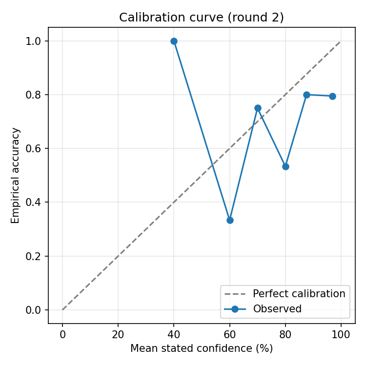
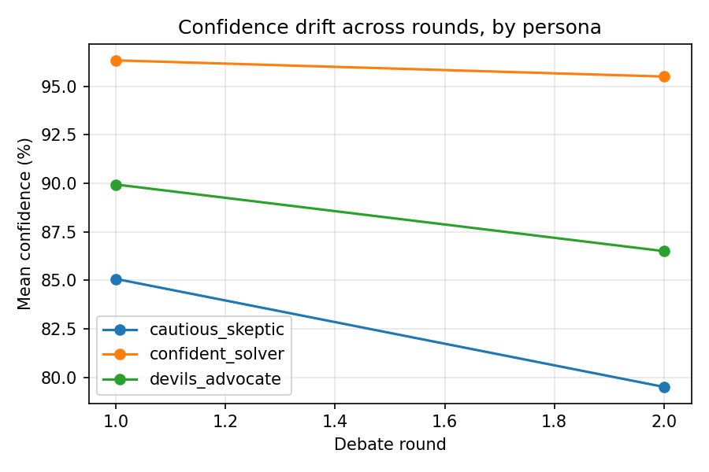

# Findings

## Setup used

- Model: llama-3.1-8b-instant (via Groq)
- Number of questions: 30
- Number of debate rounds: 2
- Date run: 2026-08-09

## 1. Does debate improve accuracy?

Round-1 (independent) accuracy: **75.6%**
Round-2 (post-debate, individual agents) accuracy: **72.2%**
Majority-vote accuracy: **80.0%**
Confidence-weighted-vote accuracy: **83.3%**

**Interpretation:** Individual agent accuracy actually *dropped* slightly after one
round of debate (75.6% → 72.2%) — seeing peers didn't make any single agent more
likely to be right. But aggregating across the three agents beat every individual
agent's accuracy at every round, and confidence-weighting the vote did better than a
plain majority vote (83.3% vs 80.0%). In other words: debate didn't make individual
agents smarter, but combining three independently-reasoning (if imperfect) opinions
still outperformed any one of them alone — the value came from aggregation, not from
the agents actually convincing each other of anything.

## 2. Calibration

ECE at round 1: **0.149**
ECE at final round: **0.167**

**Interpretation:** Calibration got slightly *worse* after debate, not better — ECE
went up, meaning the gap between stated confidence and actual correctness widened.
This lines up with the accuracy result: agents didn't get more accurate after seeing
peers, but they likely got somewhat more confident regardless (probably because
seeing another agent agree, even coincidentally, reads as validation). That's a
meaningful finding on its own — naive multi-round debate can inflate confidence
without a matching gain in correctness.

## 3. Confidence drift

**Interpretation:** _Open `confidence_drift.png` and note which line (persona) moved
the most between round 1 and round 2 — e.g., "the confident_solver persona started
highest and stayed roughly flat, while cautious_skeptic's confidence rose the most
after seeing the other two agents' answers, suggesting it was the most swayable by
peer agreement." Fill in the actual pattern you see in your plot here._

## 4. Belief flips

Flip rate: **22.2%** of all round-2 responses changed their answer from round 1
Of flips, helped (wrong → correct): **25%**
Of flips, hurt (correct → wrong): **40%**
(remaining ~35% of flips moved from one wrong answer to a different wrong answer)

**Interpretation:** When agents did change their mind, it was net negative —
flips were 1.6x more likely to move a correct answer to wrong than to fix a wrong
one. This is the clearest single result in the project: peer influence, at least in
this one-round, three-persona setup, more often destabilized correct answers than
corrected mistaken ones. That's consistent with the ECE result above — agents
appear to be responding to social agreement rather than to the actual strength of
the other agents' reasoning.

## 5. Overall takeaway

Debate alone didn't make individual agents more accurate or better calibrated — if
anything, it introduced a small net-negative belief-flip effect and slightly worse
calibration. But aggregating multiple independent (even if imperfect) opinions via
confidence-weighted voting still outperformed any single agent, including the
post-debate ones. The practical implication: the value in this setup came from
having multiple perspectives to *combine*, not from having them *argue* — which
raises the question my capstone research is actually trying to answer: whether
better-designed deliberation protocols (e.g., requiring agents to justify
disagreement with evidence rather than just restating a position) can turn debate
into a net-positive for calibration instead of a net-neutral-to-negative one.